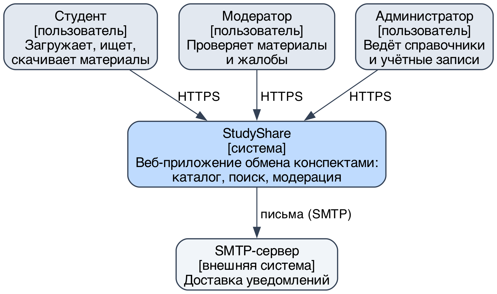
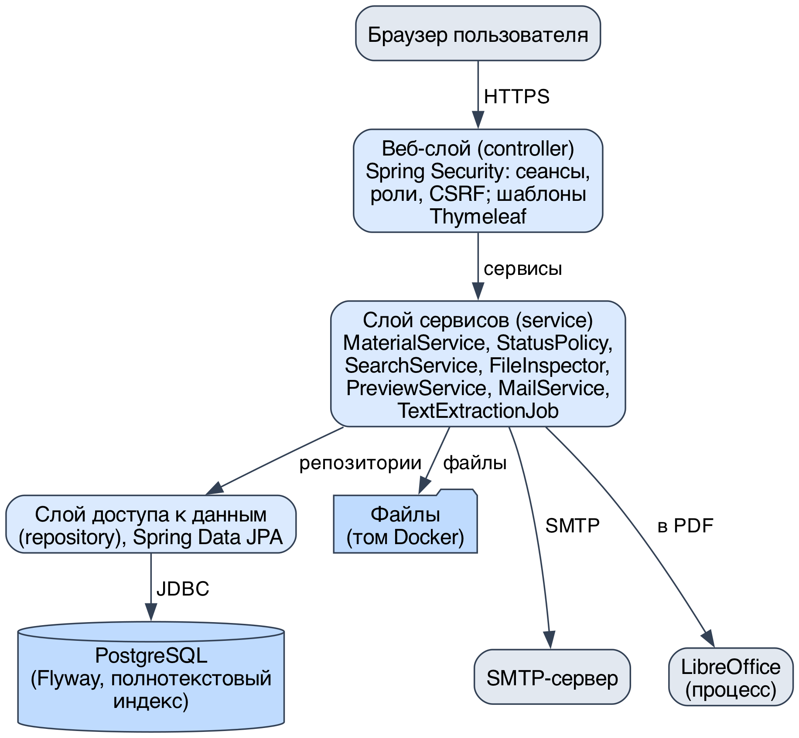
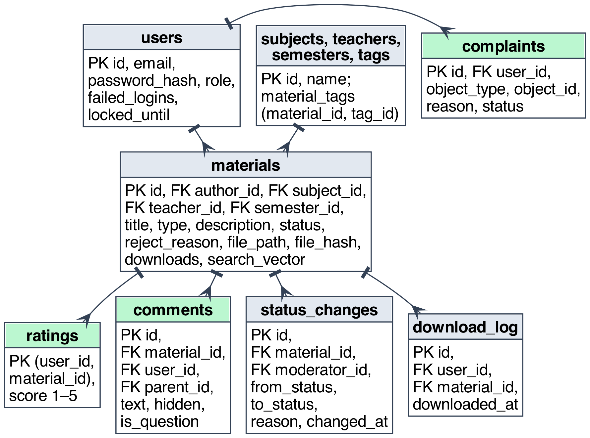
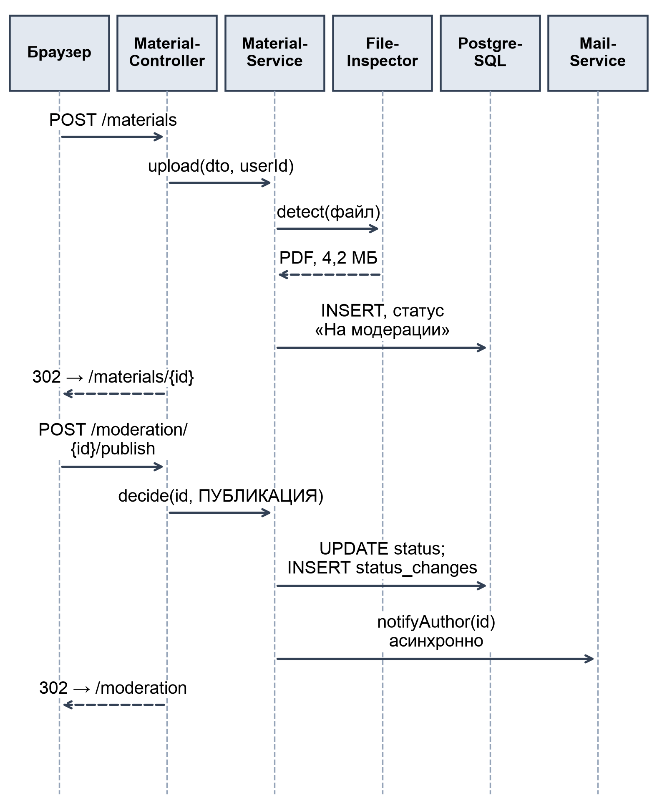
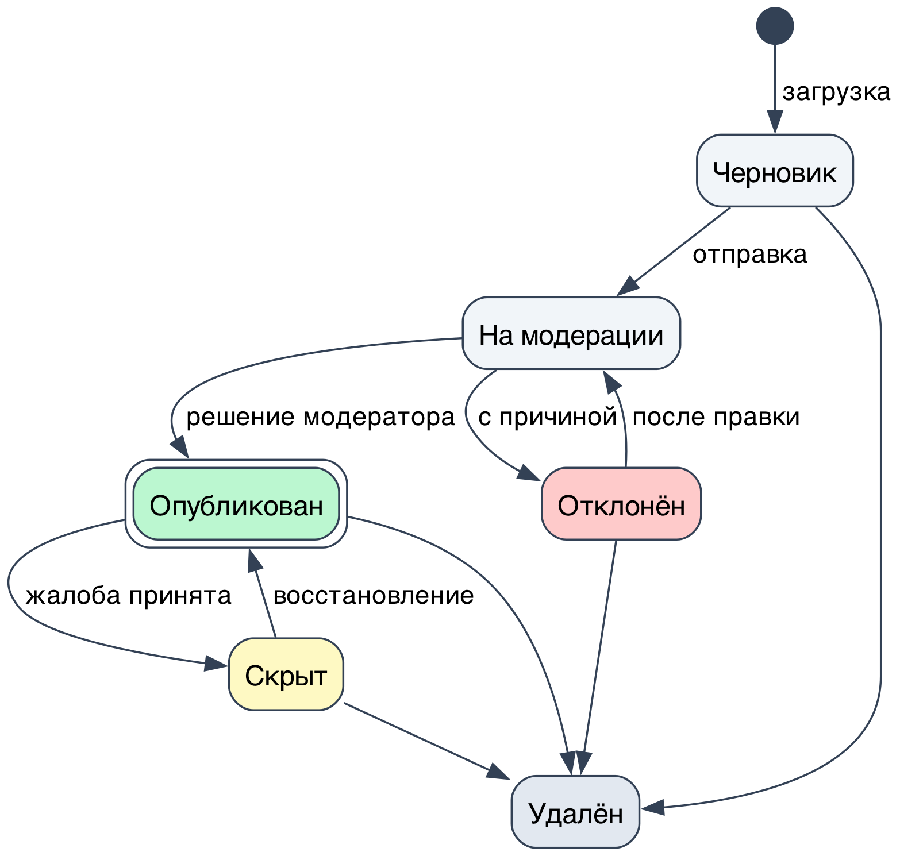
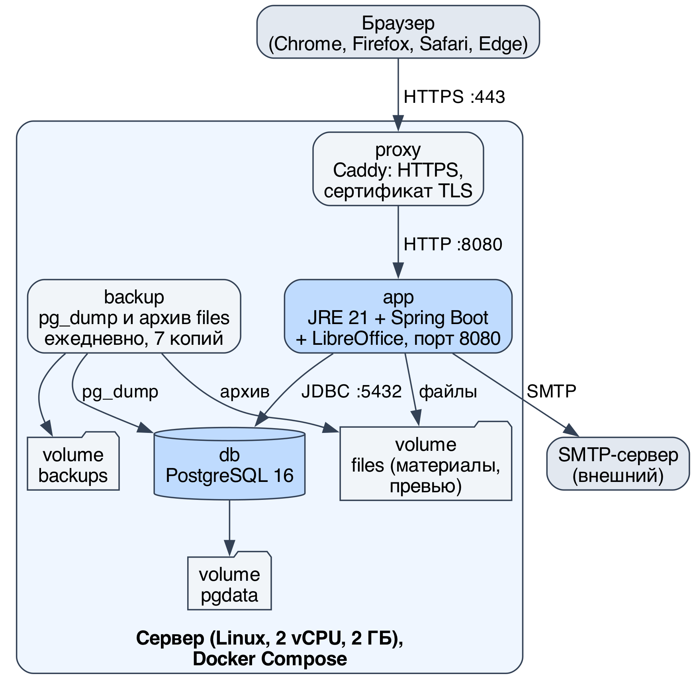

# Описание дизайна программного обеспечения

Для **StudyShare** — платформы обмена конспектами между студентами

Версия 0.3

Подготовил Апанас Е. Э., группа 450503

Белорусский государственный университет информатики и радиоэлектроники, кафедра электронных вычислительных машин

{{дата}}

## Оглавление

* [1. Введение](#1-введение)
* [2. Обзор дизайна](#2-обзор-дизайна)
* [3. Проектные представления](#3-проектные-представления)
* [4. Решения](#4-решения)
* [5. Приложения](#5-приложения)

## История изменений

| Name | Date | Reason For Changes | Version |
|------|------|--------------------|---------|
| Апанас Е. Э. | {{дата}} | Первая версия на основе SRS 0.2: контекст, композиция, логическое и информационное представления, развёртывание, ADR 0001–0006 | 0.1 |
| Апанас Е. Э. | {{дата}} | По итогам первого раунда обсуждения с заказчиком: комментарии, оценки, рейтинг, жалобы и личный кабинет вынесены в версию 1.1 (приоритет 40); уведомления по e-mail (REQ-FUNC-016) и поиск по содержимому (REQ-FUNC-013) повышены до приоритета 20; упрощены нефункциональные работы W-1…W-7 (см. план v2) | 0.2 |
| Апанас Е. Э. | {{дата}} | По итогам второго раунда: добавлена функция REQ-FUNC-017 «Предпросмотр материала», изменены композиция, взаимодействие и развёртывание, добавлен ADR 0007 | 0.3 |

---

## 1. Введение

Документ описывает, **как** будет построено веб-приложение StudyShare, требования к которому зафиксированы в `srs/srs.md` (версия 0.4). Раздел 2 определяет задачи заинтересованных сторон и выбранные точки зрения, раздел 3 содержит проектные представления, раздел 4 — перечень архитектурных решений (полные записи — в каталоге `adr/`), раздел 5 — приложения.

### 1.1 Назначение документа

SDD предназначен для разработчиков (исполнитель и подключаемый младший разработчик), которые по нему реализуют итерации, для заказчика, который проверяет, что проектные решения не противоречат его ожиданиям по срокам и стоимости, и для рецензента. Документ опирается на SRS (что должна делать система) и ссылается на записи архитектурных решений ADR (почему выбрано именно так).

### 1.2 Область применения

Проектируется StudyShare версии 1.0: веб-приложение для студентов университета с загрузкой и каталогизацией материалов, фильтрами, поиском по метаданным и содержимому, скачиванием, предпросмотром, модерацией и уведомлениями по e-mail. По итогам согласования в версию 1.0 входят требования, перечисленные в плане (`plan/plan.md`, версия v3); требования приоритета 40 (комментарии, оценки и рейтинг, жалобы, личный кабинет с историей) проектируются только на уровне точек расширения и войдут в версию 1.1.

Вне области проектирования: мобильное приложение, онлайн-редактор, платные материалы, личные сообщения, интеграция с учебными системами университета, распознавание рукописного текста (см. SRS, раздел 1.3).

### 1.3 Определения, акронимы и сокращения

| Term | Definition |
|------|------------|
| ADR | Architecture Decision Record — запись архитектурного решения |
| Tika | Apache Tika — библиотека определения типа файла и извлечения текста |
| tsvector | Тип PostgreSQL для хранения подготовленного текста при полнотекстовом поиске |
| GIN | Generalized Inverted Index — обратный индекс PostgreSQL для полнотекстового поиска |
| Flyway | Инструмент версионных миграций схемы базы данных |
| Thymeleaf | Серверный шаблонизатор HTML для Spring MVC |
| PDF.js | Библиотека просмотра PDF в браузере |
| LibreOffice headless | Запуск LibreOffice без интерфейса для преобразования документов |
| MVC | Model–View–Controller — шаблон разделения модели, представления и управления |
| SDD | Software Design Description — описание дизайна ПО |

### 1.4 Ссылки

| Источник | Тип | Расположение |
|----------|-----|--------------|
| Спецификация требований StudyShare, версия 0.4 | нормативная | `srs/srs.md` |
| IEEE 1016-2009. Systems design — Software design descriptions | справочная | — |
| ISO/IEC/IEEE 42010:2011. Architecture description | справочная | — |
| MADR 4.0 — Markdown Architectural Decision Records | справочная | `adr/adr-template.md` |
| Шаблон SDD кафедры ЭВМ БГУИР | нормативная | `sdd/sdd-template.md` |
| Записи архитектурных решений ADR 0001–0007 | нормативная | `adr/` |
| План реализации и оценки | справочная | `plan/plan.md` |
| Переписка с заказчиком | справочная | `plan/correspondence.md` |

### 1.5 Обзор документа

Раздел 2 связывает интересы сторон с точками зрения, раздел 3 даёт представления с идентификаторами вида `[ННН]-название` и ссылками на требования SRS, раздел 4 перечисляет решения со ссылками на файлы ADR. Каждое изменение документа записывается в историю изменений и повышает версию.

---

## 2. Обзор дизайна

Система проектируется как **модульный монолит**: одно приложение на Java 21 и Spring Boot, разделённое на три слоя (web – service – repository), с одной реляционной базой данных и томом для файлов. Выбор обоснован ограничением по бюджету хостинга и срокам (REQ-COST-001, REQ-DEAD-001) и небольшой нагрузкой (ADR 0001). Страницы формируются на сервере (ADR 0002), что исключает отдельное клиентское приложение. Поиск по метаданным и по содержимому выполняется средствами PostgreSQL (ADR 0004), текст из документов извлекает Apache Tika в фоновой задаче (ADR 0005).

### 2.1 Задачи стейкхолдеров

| Стейкхолдер | Основные задачи | Точки зрения |
|-------------|-----------------|--------------|
| Студент (пользователь) | Быстро найти материал; безопасно загрузить и скачать; понять, что с материалом | Контекст, Информация, Взаимодействие, Динамика состояний |
| Модератор | Проверять материалы; видеть историю решений | Взаимодействие, Динамика состояний |
| Администратор | Вести справочники и учётные записи | Контекст, Информация, Интерфейс |
| Заказчик (проверяющий проект) | Срок и стоимость; соответствие требованиям | Композиция, Развёртывание |
| Разработчики | Понятное разделение работ, независимые модули для младшего разработчика, тестируемость | Композиция, Логическое, Интерфейс, Паттерны |

### 2.2 Выбранные точки зрения

Из пятнадцати точек зрения шаблона выбраны девять, остальные не нужны по масштабу системы.

| Точка зрения | Адресует | Язык | Представление |
|--------------|----------|------|---------------|
| Контекст | Границы системы, участники | Контекстная диаграмма C4 | 001-context |
| Композиция | Слои, модули, внешние зависимости | Диаграмма компонентов | 002-composition |
| Логическое | Основные классы и ответственность | Таблица классов | 003-logical |
| Информация | Структура хранимых данных | Диаграмма «сущность–связь» | 004-information |
| Интерфейс | Маршруты и внешние контракты | Таблица маршрутов | 005-interface |
| Взаимодействие | Порядок вызовов при загрузке и публикации материала | Диаграмма последовательности | 006-interaction |
| Динамика состояний | Статусы материала | Диаграмма состояний | 007-state |
| Паттерны | Применяемые шаблоны проектирования | Таблица | 008-patterns |
| Развёртывание | Контейнеры и узлы | Диаграмма развёртывания | 009-deployment |

Точки зрения «Физическое представление», «Структура», «Зависимости», «Алгоритм», «Параллелизм», «Ресурсы» отдельных представлений не получили: топология сводится к одному серверу (входит в 009), фоновое извлечение текста описано в ADR 0005, ресурсные ограничения — в REQ-PERF-001…003 и REQ-COST-001.

---

## 3. Проектные представления

### 001-context. Контекст

- **Viewpoint**: Контекст
- **Representation**: система StudyShare взаимодействует с тремя видами пользователей — студентом, модератором и администратором (через браузер по HTTPS) — и одной внешней системой — SMTP-сервером, который доставляет письма о результатах модерации и ответах на вопросы (рисунок 1).

- **More Information**: SRS, раздел 2.1; REQ-INT-003; ADR 0001.

### 002-composition. Композиция

- **Viewpoint**: Композиция
- **Representation**: приложение разделено на три слоя; зависимости направлены только вниз (рисунок 2). Веб-слой принимает запросы, проверяет вход и права (Spring Security), вызывает сервисы и формирует HTML (Thymeleaf). Слой сервисов содержит бизнес-правила: допустимость переходов статусов (`StatusPolicy`), проверку файла (`FileInspector`, Tika), хранение файлов (`FileStorage`), поиск (`SearchService`), предпросмотр (`PreviewService`), отправку писем (`MailService`) и фоновое извлечение текста (`TextExtractionJob`). Слой доступа к данным состоит из репозиториев Spring Data JPA. Пакеты Java: `by.bsuir.studyshare.{web, service, repository, domain, config}`. Файлы материалов и превью хранятся на томе (ADR 0006); для преобразования DOCX и PPTX в PDF вызывается процесс LibreOffice (ADR 0007).

- **More Information**: REQ-MAINT-001; ADR 0001, 0002, 0006, 0007; модули `MailService` и `FileStorage` изолированы за интерфейсами для замены реализации.

### 003-logical. Логическое представление

- **Viewpoint**: Логическое
- **Representation**: ключевые классы и их ответственность.

| Класс | Слой | Ответственность | Требования |
|-------|------|-----------------|------------|
| `User` | domain | Учётная запись, роль, счётчик неудачных входов | REQ-FUNC-001, 002, REQ-SEC-004 |
| `Material`, `StatusChange` | domain | Материал, метаданные, статус и история решений | REQ-FUNC-003, 004, 008 |
| `Subject`, `Teacher`, `Semester`, `Tag` | domain | Справочники и теги | REQ-FUNC-005, 007 |
| `StatusPolicy` | service | Таблица допустимых переходов статусов; единственное место правил | REQ-FUNC-008 |
| `MaterialService` | service | Загрузка, отправка на модерацию, скачивание и учёт скачиваний | REQ-FUNC-003, 006 |
| `FileInspector` | service | Определение типа по содержимому, проверка размера | REQ-SEC-002 |
| `FileStorage` | service | Сохранение и выдача файлов (интерфейс + реализация на файловой системе) | REQ-FUNC-003, 006 |
| `SearchService` | service | Поиск по названию, тегам, описанию и содержимому; фильтры | REQ-FUNC-005, 012, 013 |
| `TextExtractionJob` | service | Фоновое извлечение текста и обновление `search_vector` | REQ-FUNC-013 |
| `PreviewService` | service | Преобразование документа в PDF и выдача превью | REQ-FUNC-017 |
| `MailService` | service | Отправка писем о модерации и ответах | REQ-FUNC-016, REQ-INT-003 |
| `RatingService`, `CommentService`, `ComplaintService` | service | Оценки, рейтинг, комментарии, жалобы (версия 1.1) | REQ-FUNC-009…011, 015 |

- **More Information**: модель данных — представление 004.

### 004-information. Информация

- **Viewpoint**: Информация
- **Representation**: данные хранятся в PostgreSQL; схема создаётся миграциями Flyway (`V1__init.sql`, далее по одной миграции на изменение). Основные таблицы и связи показаны на рисунке 3. Идентификаторы — `bigint`; даты и моменты времени — `timestamptz`. Материал связан с автором, предметом, преподавателем и семестром; теги — через таблицу связей `material_tags`. Столбец `search_vector` (`tsvector`) собирается из названия, тегов, описания и извлечённого текста; по нему построен GIN-индекс (ADR 0004). Хэш файла `file_hash` (SHA-256) позволяет находить повторную загрузку. Каждое решение по материалу записывается в `status_changes` с автором и временем (REQ-FUNC-008). Таблицы `ratings`, `comments`, `complaints` (на рисунке выделены зелёным) создаются миграциями версии 1.1; в схеме 1.0 их нет, но их внешние ключи на `materials` и `users` предусмотрены.

- **More Information**: SRS, раздел 2.3; REQ-INT-002, REQ-SEC-002, REQ-COMP-001; ADR 0003, 0004, 0006.

### 005-interface. Интерфейс

- **Viewpoint**: Интерфейс
- **Representation**: внешний интерфейс — HTML-страницы и выдача файлов по HTTPS; REST API не предоставляется. Основные маршруты:

| Маршрут | Метод | Назначение | Требование |
|---------|-------|------------|------------|
| `/register`, `/login`, `/logout` | GET, POST | Регистрация и вход | REQ-FUNC-001 |
| `/` , `/catalog` | GET | Каталог, фильтры, сортировка | REQ-FUNC-004, 005 |
| `/search` | GET | Поиск по названию, тегам, описанию, содержимому | REQ-FUNC-012, 013 |
| `/materials/new`, `/materials` | GET, POST | Форма и загрузка материала | REQ-FUNC-003 |
| `/materials/{id}` | GET | Страница материала | REQ-FUNC-004, 017 |
| `/materials/{id}/download` | GET | Скачивание файла с учётом | REQ-FUNC-006 |
| `/materials/{id}/preview` | GET | Выдача превью (PDF) для просмотрщика | REQ-FUNC-017 |
| `/moderation`, `/moderation/{id}/publish`, `/moderation/{id}/reject` | GET, POST | Очередь и решения модератора | REQ-FUNC-008 |
| `/admin/subjects`, `/admin/teachers`, `/admin/semesters` | GET, POST | Справочники | REQ-FUNC-007 |
| `/actuator/health` | GET | Проверка состояния | REQ-AVAIL-001 |

Внутренние контракты — интерфейсы `FileStorage.save/open` и `MailService.send(Message)`. Исходящий интерфейс — SMTP (адрес, порт, логин, пароль, шифрование из переменных окружения).

- **More Information**: ADR 0002; REQ-INT-001, REQ-INT-003.

### 006-interaction. Взаимодействие

- **Viewpoint**: Взаимодействие
- **Representation**: сценарий «загрузка материала и публикация модератором» показан на рисунке 4. При загрузке тип файла определяется по содержимому синхронно, и файл с неподходящим типом отклоняется сразу (REQ-SEC-002); материал получает статус «На модерации». Решение модератора проверяется `StatusPolicy`, пишется в историю и приводит к асинхронной отправке письма автору. Извлечение текста для поиска и подготовка превью выполняются фоновыми задачами после публикации. Путь отказа: при недоступности SMTP письмо ставится в очередь повторной отправки, решение модератора не откатывается.

- **More Information**: REQ-FUNC-003, 008, 013, 016, 017, REQ-SEC-002, REQ-PERF-003; ADR 0005, 0007.

### 007-state. Динамика состояний

- **Viewpoint**: Динамика состояний
- **Representation**: статусы материала и допустимые переходы (рисунок 5). Правила хранятся в одном классе `StatusPolicy` в виде таблицы «из статуса – в статусы» (соответствует таблице SRS 2.4); каждый переход записывается в `status_changes`. Недопустимый переход отклоняется. Скрытый жалобой материал исчезает из каталога, но может быть восстановлен модератором.

- **More Information**: SRS, раздел 2.4; REQ-FUNC-008, REQ-FUNC-015.

### 008-patterns. Паттерны

- **Viewpoint**: Паттерны
- **Representation**:

| Паттерн | Где применён | Зачем |
|---------|--------------|-------|
| Слоистая архитектура | Всё приложение | Разделение ответственности, тестируемость сервисов |
| Repository | `repository` | Скрытие хранения, подмена в тестах |
| Strategy / интерфейс | `FileStorage`, `MailService` | Замена реализации (файловая система → S3, SMTP → другой провайдер) |
| Table-driven policy | `StatusPolicy` | Правила переходов в одном месте, проверяются таблично |
| Chain of Responsibility | Проверка загружаемого файла | Последовательные проверки: размер, тип, повторная загрузка |
| Background job | `TextExtractionJob`, преобразование превью | Долгие операции вне запроса пользователя (ADR 0005) |
| Template Method / Thymeleaf-фрагменты | Шаблоны страниц | Единый каркас страниц и навигации |

- **More Information**: REQ-MAINT-001.

### 009-deployment. Развёртывание

- **Viewpoint**: Развёртывание
- **Representation**: Docker Compose запускает четыре контейнера на одном сервере (рисунок 6): `proxy` (Caddy — HTTPS и перенаправление), `app` (JRE 21, исполняемый jar и LibreOffice для превью), `db` (PostgreSQL 16 с томом `pgdata`), `backup` (ежедневная копия базы и тома `files`, хранение семи копий в томе `backups`). Параметры (база, SMTP, секреты) передаются переменными окружения; откат — запуск предыдущего образа. Сервер: 2 vCPU, 2 ГБ памяти.

- **More Information**: REQ-REL-001, REQ-AVAIL-001, REQ-SEC-003, REQ-COST-001; ADR 0001, 0003, 0006, 0007.

---

## 4. Решения

| ID | Решение | Файл |
|----|---------|------|
| 0001 | Модульный монолит на Spring Boot вместо микросервисов | `adr/0001-monolith-spring-boot.md` |
| 0002 | Серверный рендеринг на Thymeleaf вместо одностраничного приложения | `adr/0002-server-side-rendering.md` |
| 0003 | PostgreSQL и миграции Flyway | `adr/0003-postgresql-flyway.md` |
| 0004 | Полнотекстовый поиск средствами PostgreSQL | `adr/0004-postgres-full-text-search.md` |
| 0005 | Apache Tika для проверки типа файла и извлечения текста | `adr/0005-tika-text-extraction.md` |
| 0006 | Хранение файлов на томе Docker, метаданные в базе | `adr/0006-file-storage-volume.md` |
| 0007 | Предпросмотр материала: LibreOffice и PDF.js | `adr/0007-preview-libreoffice-pdfjs.md` |

---

## 5. Приложения

### Приложение А. Соответствие требований и представлений

| Требование | Представления |
|------------|---------------|
| REQ-FUNC-001, 002, REQ-SEC-001, 003, 004 | 002, 003, 005 |
| REQ-FUNC-003, 006, REQ-SEC-002, REQ-PERF-003 | 003, 004, 005, 006 |
| REQ-FUNC-004, 005, 007 | 003, 004, 005 |
| REQ-FUNC-008 | 003, 004, 005, 006, 007 |
| REQ-FUNC-012, 013, REQ-PERF-002 | 003, 004, 005, 006 |
| REQ-FUNC-016, REQ-INT-003 | 003, 006, 008 |
| REQ-FUNC-017 | 002, 003, 005, 009 |
| REQ-INT-002, REQ-COMP-001, 002 | 004 |
| REQ-REL-001, REQ-AVAIL-001, REQ-COST-001 | 009 |

Требования, перенесённые в версию 1.1 (REQ-FUNC-009, 010, 011, 014, 015), в представлениях не детализированы; для них заложены точки расширения: таблицы `ratings`, `comments`, `complaints` с внешними ключами на `materials`, статус «Скрыт» в `StatusPolicy`, интерфейс `MailService` для писем об ответах на вопросы.
