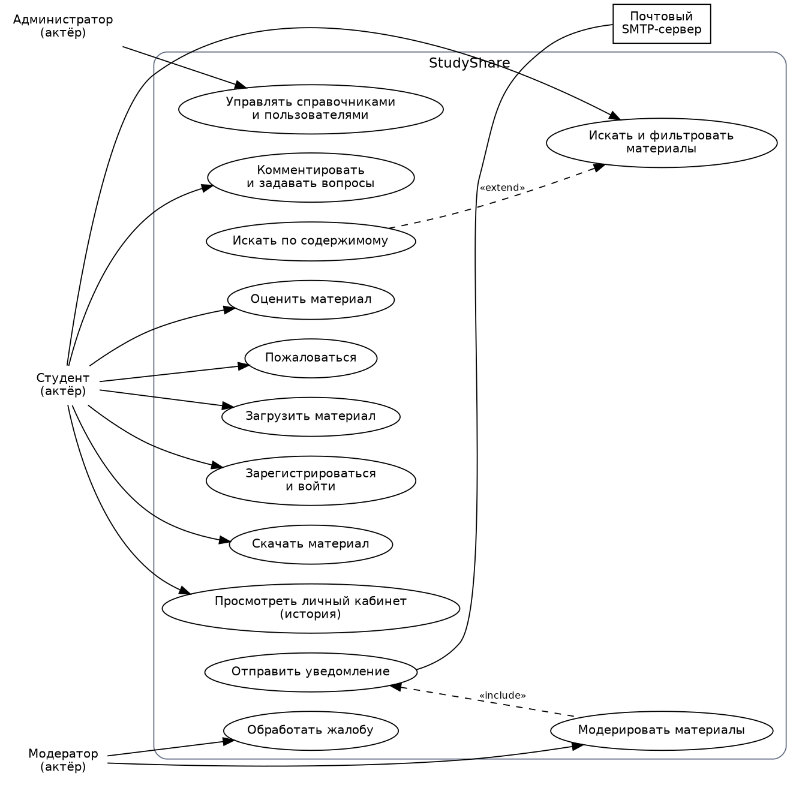
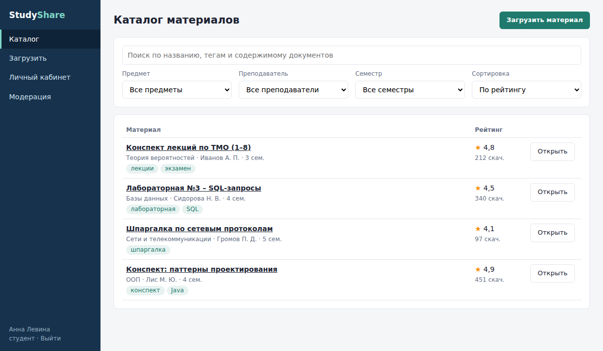
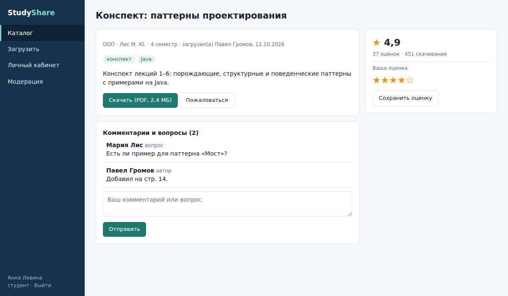
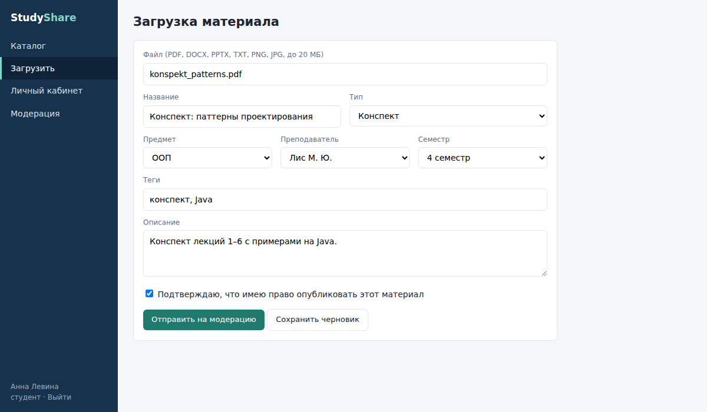
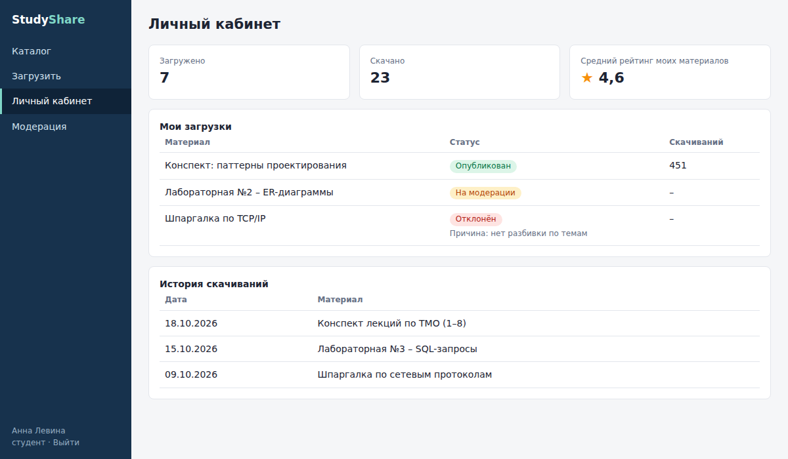
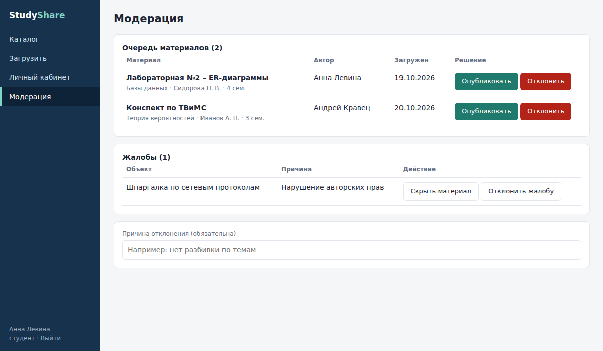
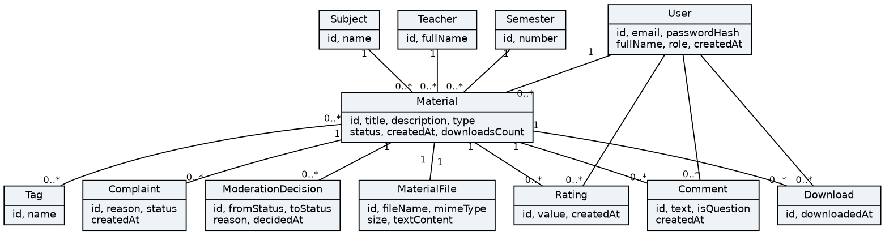

# Спецификация требований к ПО (SRS) – StudyShare

| Поле | Значение |
|---|---|
| Проект | StudyShare – платформа обмена конспектами между студентами |
| Версия | 0.2 |
| Статус | Черновик, учтены замечания заказчика |
| Автор (менеджер проекта) | [ФИО] |
| Заказчик | [ФИО напарника] |
| Репозиторий | https://github.com/plightick/SDLC |

> Примечание: структура ниже следует разделам шаблона `srs/srs-template.md` (введение, обзор продукта, требования, верификация, приложения). Если заголовки в вашем шаблоне названы иначе – переименуйте разделы под шаблон, а содержимое оставьте.

## История изменений

| Версия | Дата | Изменение |
|---|---|---|
| 0.1 | [дата] | Первая редакция бизнес-требований |
| 0.2 | [дата] | Учтены замечания заказчика (REQ-FUNC-015, REQ-FUNC-016) |

## 1 Введение

### 1.1 Назначение
Документ описывает требования к веб-приложению StudyShare: загрузка и каталогизация конспектов, лабораторных работ и учебных материалов с тегами, фильтрами, рейтингом, комментариями, поиском по содержимому, личным кабинетом и модерацией.

### 1.2 Бизнес-цели

| Код | Цель | Критерий достижения |
|---|---|---|
| БЦ-1 | Сократить время поиска нужного материала | Не более 2 минут от входа до скачивания материала по предмету и семестру |
| БЦ-2 | Обеспечить качество публикуемых материалов | Не менее 95 % материалов проходят проверку модератором в течение 24 часов |
| БЦ-3 | Накопить востребованную базу материалов | Не менее 500 опубликованных материалов за первый семестр эксплуатации |

### 1.3 Границы проекта
**В версии 1.0:** регистрация и роли; загрузка материалов с метаданными; каталог с тегами и фильтрами; скачивание; оценки и рейтинг; комментарии и вопросы; поиск по метаданным и по содержимому; личный кабинет; модерация и жалобы; e-mail уведомления.

**Вне версии 1.0:** мобильное приложение; онлайн-редактор конспектов; платные материалы и онлайн-оплата; личные сообщения; интеграция с учебными системами университета; распознавание рукописного текста.

### 1.4 Определения
- **Материал** – загруженный студентом файл (конспект, лабораторная работа, шпаргалка и т. п.) с метаданными.
- **Модерация** – проверка материала перед публикацией.
- **Рейтинг** – показатель, рассчитанный по средней оценке и числу скачиваний.
- MoSCoW – метод приоритизации: Must, Should, Could, Won't.

## 2 Обзор продукта

### 2.1 Роли пользователей

| Роль | Описание |
|---|---|
| Студент | Загружает, ищет, скачивает, оценивает и комментирует материалы |
| Модератор | Проверяет материалы и жалобы |
| Администратор | Управляет справочниками и пользователями |
| Почтовый SMTP-сервер (внешняя система) | Отправляет уведомления |

### 2.2 Технологии и ограничения
Java 21, Spring Boot (MVC, Data JPA, Security), Thymeleaf, PostgreSQL, Apache Tika, Flyway, Maven, Docker. Веб-приложение, страницы формируются на сервере.

### 2.3 Графические материалы
- Диаграмма вариантов использования: `img/use-cases.png` (исходник `sysml/use-cases.dot`).
- Иерархия функциональных требований: `img/func-req-tree.png`.
- Иерархия нефункциональных требований: `img/nonfunc-req-tree.png`.
- Модель предметной области: `img/domain-model.png`.
- Мокапы экранов: `img/catalog.png`, `img/material.png`, `img/upload.png`, `img/profile.png`, `img/moderation.png` (исходники в `mockups/`).
- Текстовая модель требований SysML v2: `sysml/studyshare.sysml`.

### 2.4 Жизненный цикл материала

| Из статуса | В статус |
|---|---|
| Черновик | На модерации, Удалён |
| На модерации | Опубликован, Отклонён |
| Отклонён | На модерации (после правки), Удалён |
| Опубликован | Скрыт, Удалён |
| Скрыт | Опубликован, Удалён |
| Удалён | – |

## 3 Требования

### 3.1 Функциональные требования

#### REQ-FUNC-001 – Регистрация и вход
- **Приоритет:** Must; **итерация:** 1
- **Формулировка:** Система должна позволять пользователю зарегистрироваться по e-mail и паролю и войти в систему.
- **Обоснование:** [кратко: зачем это нужно заказчику – согласуйте с БЦ-1…БЦ-3]
- **Критерий приёмки:** Регистрация с корректными данными создаёт аккаунт; неверный пароль отклоняется.
- **Метод проверки:** Испытание

#### REQ-FUNC-002 – Роли и права доступа
- **Приоритет:** Must; **итерация:** 1
- **Формулировка:** Система должна разграничивать права ролей: студент, модератор, администратор.
- **Обоснование:** [кратко: зачем это нужно заказчику – согласуйте с БЦ-1…БЦ-3]
- **Критерий приёмки:** Студент не видит страницу модерации; модератор не управляет справочниками.
- **Метод проверки:** Испытание

#### REQ-FUNC-003 – Загрузка материала с метаданными
- **Приоритет:** Must; **итерация:** 1
- **Формулировка:** Система должна позволять студенту загрузить файл с указанием названия, типа, предмета, преподавателя, семестра, тегов и описания.
- **Обоснование:** [кратко: зачем это нужно заказчику – согласуйте с БЦ-1…БЦ-3]
- **Критерий приёмки:** Файл допустимого типа до 20 МБ сохраняется и получает статус «На модерации».
- **Метод проверки:** Испытание

#### REQ-FUNC-004 – Каталог материалов и теги
- **Приоритет:** Must; **итерация:** 1
- **Формулировка:** Система должна показывать каталог опубликованных материалов с тегами.
- **Обоснование:** [кратко: зачем это нужно заказчику – согласуйте с БЦ-1…БЦ-3]
- **Критерий приёмки:** В каталоге видны только материалы со статусом «Опубликован».
- **Метод проверки:** Демонстрация

#### REQ-FUNC-005 – Фильтры по предмету, преподавателю, семестру
- **Приоритет:** Must; **итерация:** 1
- **Формулировка:** Система должна фильтровать каталог по предмету, преподавателю и семестру (в любом сочетании).
- **Обоснование:** [кратко: зачем это нужно заказчику – согласуйте с БЦ-1…БЦ-3]
- **Критерий приёмки:** Результат содержит только материалы, подходящие под все выбранные фильтры.
- **Метод проверки:** Испытание

#### REQ-FUNC-006 – Скачивание и учёт скачиваний
- **Приоритет:** Must; **итерация:** 1
- **Формулировка:** Система должна позволять скачать опубликованный материал и фиксировать каждое скачивание в истории пользователя.
- **Обоснование:** [кратко: зачем это нужно заказчику – согласуйте с БЦ-1…БЦ-3]
- **Критерий приёмки:** После скачивания счётчик материала увеличивается на 1, запись появляется в кабинете.
- **Метод проверки:** Испытание

#### REQ-FUNC-007 – Справочники предметов, преподавателей, семестров
- **Приоритет:** Should; **итерация:** 1
- **Формулировка:** Система должна позволять администратору добавлять, изменять и удалять предметы, преподавателей и семестры.
- **Обоснование:** [кратко: зачем это нужно заказчику – согласуйте с БЦ-1…БЦ-3]
- **Критерий приёмки:** Новый предмет доступен в форме загрузки и фильтрах.
- **Метод проверки:** Демонстрация

#### REQ-FUNC-008 – Модерация материалов
- **Приоритет:** Must; **итерация:** 2
- **Формулировка:** Система должна передавать загруженные материалы модератору, который публикует или отклоняет их с указанием причины; допустимые переходы статусов заданы таблицей переходов.
- **Обоснование:** [кратко: зачем это нужно заказчику – согласуйте с БЦ-1…БЦ-3]
- **Критерий приёмки:** Недопустимый переход отклоняется; каждое решение записывается в историю с автором и временем.
- **Метод проверки:** Испытание

#### REQ-FUNC-009 – Оценки материалов
- **Приоритет:** Should; **итерация:** 2
- **Формулировка:** Система должна позволять студенту поставить опубликованному материалу оценку от 1 до 5 (одну на материал, с возможностью изменить).
- **Обоснование:** [кратко: зачем это нужно заказчику – согласуйте с БЦ-1…БЦ-3]
- **Критерий приёмки:** Повторная оценка заменяет прежнюю; автор не может оценить свой материал.
- **Метод проверки:** Испытание

#### REQ-FUNC-010 – Рейтинг материалов
- **Приоритет:** Should; **итерация:** 2
- **Формулировка:** Система должна вычислять рейтинг материала на основе средней оценки и числа скачиваний и позволять сортировать каталог по рейтингу.
- **Обоснование:** [кратко: зачем это нужно заказчику – согласуйте с БЦ-1…БЦ-3]
- **Критерий приёмки:** Каталог при сортировке «по рейтингу» упорядочен по убыванию рейтинга.
- **Метод проверки:** Анализ

#### REQ-FUNC-011 – Комментарии и вопросы к материалам
- **Приоритет:** Should; **итерация:** 2
- **Формулировка:** Система должна позволять оставлять комментарии и вопросы к материалу и отвечать на них.
- **Обоснование:** [кратко: зачем это нужно заказчику – согласуйте с БЦ-1…БЦ-3]
- **Критерий приёмки:** Комментарий виден на странице материала сразу после отправки.
- **Метод проверки:** Испытание

#### REQ-FUNC-012 – Поиск по названию, тегам и описанию
- **Приоритет:** Must; **итерация:** 2
- **Формулировка:** Система должна выполнять поиск материалов по названию, тегам и описанию.
- **Обоснование:** [кратко: зачем это нужно заказчику – согласуйте с БЦ-1…БЦ-3]
- **Критерий приёмки:** Запрос по слову из названия возвращает соответствующий материал.
- **Метод проверки:** Испытание

#### REQ-FUNC-013 – Поиск по содержимому документов
- **Приоритет:** Should; **итерация:** 3
- **Формулировка:** Система должна извлекать текст из загруженных документов и выполнять поиск по нему.
- **Обоснование:** [кратко: зачем это нужно заказчику – согласуйте с БЦ-1…БЦ-3]
- **Критерий приёмки:** Запрос по фразе из тела документа находит этот документ.
- **Метод проверки:** Испытание

#### REQ-FUNC-014 – Личный кабинет: история загрузок и скачиваний
- **Приоритет:** Should; **итерация:** 2
- **Формулировка:** Система должна показывать пользователю его загрузки (со статусами и причиной отклонения) и историю скачиваний.
- **Обоснование:** [кратко: зачем это нужно заказчику – согласуйте с БЦ-1…БЦ-3]
- **Критерий приёмки:** Все загрузки и скачивания пользователя отображены в кабинете.
- **Метод проверки:** Демонстрация

#### REQ-FUNC-015 – Жалобы на материалы и комментарии
- **Приоритет:** Could; **итерация:** 3
- **Формулировка:** Система должна позволять пожаловаться на материал или комментарий, а модератору – скрыть объект или отклонить жалобу.
- **Обоснование:** [кратко: зачем это нужно заказчику – согласуйте с БЦ-1…БЦ-3]
- **Критерий приёмки:** Жалоба попадает в очередь модератора; скрытый материал пропадает из каталога.
- **Метод проверки:** Испытание

#### REQ-FUNC-016 – Уведомления по e-mail
- **Приоритет:** Could; **итерация:** 3
- **Формулировка:** Система должна отправлять e-mail о результате модерации и об ответе на вопрос пользователя.
- **Обоснование:** [кратко: зачем это нужно заказчику – согласуйте с БЦ-1…БЦ-3]
- **Критерий приёмки:** Письмо отправляется на адрес пользователя в течение 5 минут после события.
- **Метод проверки:** Испытание

### 3.2 Нефункциональные требования

| Идентификатор | Требование | Целевое значение | Метод проверки |
|---|---|---|---|
| REQ-PERF-001 | Время отклика страниц | Не более 1,5 с для 95 % запросов | Испытание |
| REQ-PERF-002 | Поиск по содержимому | Не более 3 с для 95 % запросов при базе до 10 000 документов | Испытание |
| REQ-PERF-003 | Загрузка файла до 20 МБ | Не более 30 с при канале 10 Мбит/с | Испытание |
| REQ-SEC-001 | Хранение паролей | bcrypt, стоимость не менее 10 | Инспекция |
| REQ-SEC-002 | Проверка загружаемых файлов | Только PDF, DOCX, PPTX, TXT, PNG, JPG; не более 20 МБ; тип проверяется по содержимому | Испытание |
| REQ-SEC-003 | Защита веб-приложения | Защита от CSRF, XSS и SQL-инъекций | Инспекция |
| REQ-SEC-004 | Сеансы и блокировка входа | Сеанс 30 минут; блокировка на 15 минут после пяти неудачных попыток | Испытание |
| REQ-REL-001 | Резервные копии базы и файлов | Ежедневно, хранятся семь последних | Демонстрация |
| REQ-AVAIL-001 | Доступность сервиса | Не менее 99 % за месяц | Анализ |
| REQ-COMP-001 | Персональные данные | Хранится минимум данных; удаление аккаунта по запросу | Инспекция |
| REQ-COMP-002 | Авторские права | Подтверждение права на публикацию при загрузке; удаление по обоснованному обращению правообладателя | Инспекция |
| REQ-INT-001 | Веб-интерфейс | На русском языке, адаптивный (от 360 px) | Демонстрация |
| REQ-INT-002 | Хранение данных | PostgreSQL | Инспекция |
| REQ-INT-003 | Отправка почты | По протоколу SMTP | Демонстрация |
| REQ-MAINT-001 | Покрытие тестами сервисного слоя | Не менее 70 % | Анализ |
| REQ-COST-001 | Стоимость хостинга | Не более 10 USD в месяц | Анализ |

## 4 Верификация

Матрица трассируемости: каждое требование связано с методом проверки (испытание, анализ, инспекция, демонстрация) и артефактом. На текущем этапе реализация не начата, поэтому статус всех строк – «Запланировано».

| Требование | Метод | Артефакт | Статус |
|---|---|---|---|
| REQ-FUNC-001 | Испытание | [тест-кейс TC-001] | Запланировано |
| REQ-FUNC-002 | Испытание | [тест-кейс TC-002] | Запланировано |
| REQ-FUNC-003 | Испытание | [тест-кейс TC-003] | Запланировано |
| REQ-FUNC-004 | Демонстрация | [тест-кейс TC-004] | Запланировано |
| REQ-FUNC-005 | Испытание | [тест-кейс TC-005] | Запланировано |
| REQ-FUNC-006 | Испытание | [тест-кейс TC-006] | Запланировано |
| REQ-FUNC-007 | Демонстрация | [тест-кейс TC-007] | Запланировано |
| REQ-FUNC-008 | Испытание | [тест-кейс TC-008] | Запланировано |
| REQ-FUNC-009 | Испытание | [тест-кейс TC-009] | Запланировано |
| REQ-FUNC-010 | Анализ | [тест-кейс TC-010] | Запланировано |
| REQ-FUNC-011 | Испытание | [тест-кейс TC-011] | Запланировано |
| REQ-FUNC-012 | Испытание | [тест-кейс TC-012] | Запланировано |
| REQ-FUNC-013 | Испытание | [тест-кейс TC-013] | Запланировано |
| REQ-FUNC-014 | Демонстрация | [тест-кейс TC-014] | Запланировано |
| REQ-FUNC-015 | Испытание | [тест-кейс TC-015] | Запланировано |
| REQ-FUNC-016 | Испытание | [тест-кейс TC-016] | Запланировано |
| REQ-PERF-001 | Испытание | [тест-кейс / отчёт] | Запланировано |
| REQ-PERF-002 | Испытание | [тест-кейс / отчёт] | Запланировано |
| REQ-PERF-003 | Испытание | [тест-кейс / отчёт] | Запланировано |
| REQ-SEC-001 | Инспекция | [тест-кейс / отчёт] | Запланировано |
| REQ-SEC-002 | Испытание | [тест-кейс / отчёт] | Запланировано |
| REQ-SEC-003 | Инспекция | [тест-кейс / отчёт] | Запланировано |
| REQ-SEC-004 | Испытание | [тест-кейс / отчёт] | Запланировано |
| REQ-REL-001 | Демонстрация | [тест-кейс / отчёт] | Запланировано |
| REQ-AVAIL-001 | Анализ | [тест-кейс / отчёт] | Запланировано |
| REQ-COMP-001 | Инспекция | [тест-кейс / отчёт] | Запланировано |
| REQ-COMP-002 | Инспекция | [тест-кейс / отчёт] | Запланировано |
| REQ-INT-001 | Демонстрация | [тест-кейс / отчёт] | Запланировано |
| REQ-INT-002 | Инспекция | [тест-кейс / отчёт] | Запланировано |
| REQ-INT-003 | Демонстрация | [тест-кейс / отчёт] | Запланировано |
| REQ-MAINT-001 | Анализ | [тест-кейс / отчёт] | Запланировано |
| REQ-COST-001 | Анализ | [тест-кейс / отчёт] | Запланировано |

## 5 Приложения

### 5.1 Рецензирование заказчиком (pull request)

| Замечание | Решение | Обоснование |
|---|---|---|
| [вписать реальные замечания из PR] | Принято / Отклонено | [обоснование] |
